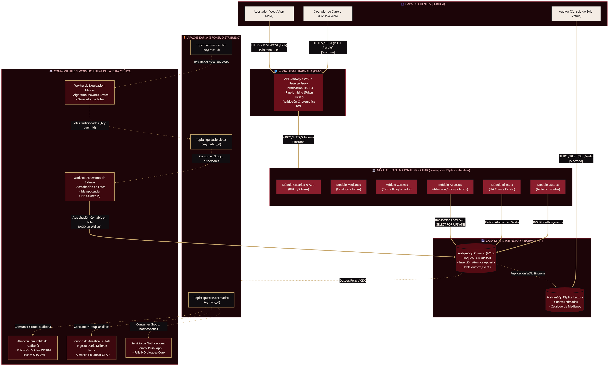
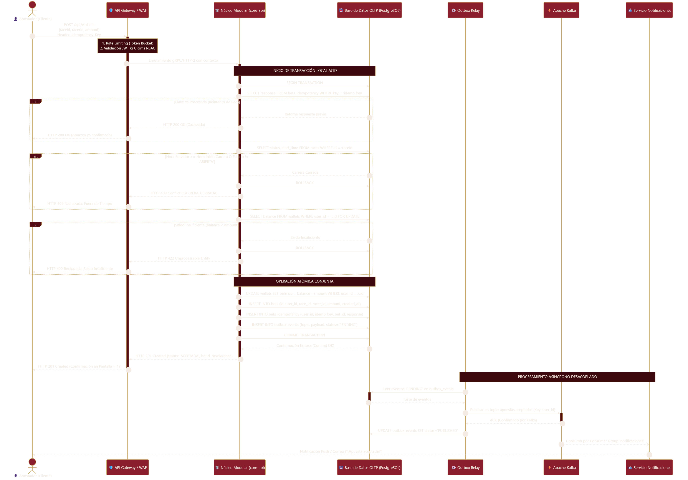
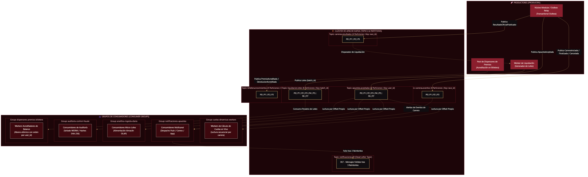
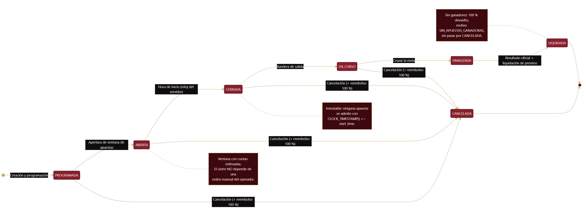

<p align="center">
  
</p>

<p align="center">
  
</p>

<p align="center">
  
  
  
  
  
</p>

Diseño y justificación de la arquitectura de **La Gran Liga de Apuestas de Medianos**: plataforma de apuestas mutuas (*pari-mutuel*) sobre carreras de medianos, para **Salchipapa Maker Racing S.A.S.** Soporta una carga base de 500 usuarios y picos de **100.000 concurrentes** con ráfagas de **10.000 apuestas/s** durante los 30 segundos previos al cierre.

> Los **EIA Coins** son créditos exclusivamente ficticios del caso: sin valor monetario. Este repositorio documenta únicamente el **diseño**: no hay backend, base de datos ni broker en ejecución.

<p align="center">
  
</p>

## Requisitos y Atributos de Calidad

| Parámetro | Valor Objetivo | Implicación Arquitectónica |
|---|---|---|
| Usuarios concurrentes | 500 (carrera normal) · 100.000 (final) | Núcleo *stateless* replicable tras balanceador; consulta en réplicas |
| Pico transaccional | 10.000 apuestas/s × 30 s (300k tx) | Outbox transaccional + particionamiento por clave de negocio |
| Latencia al apostar | < 1 s (aceptada/rechazada) | Presupuesto 330-660 ms; circuit breaker 600 ms → HTTP 504 |
| Pérdida de datos | Ninguna (apuesta o movimiento) | ACID local + replicación WAL síncrona + Outbox |
| Liquidación de premios | < 15 min (> 1.000.000 apuestas) | Reparto global previo + lotes de acreditación en paralelo |
| Auditoría | Registro inmutable ≥ 5 años | WORM / Object Lock, solo lectura |
| Estadísticas | Minutos de retraso (reportes: 1 día) | Ingesta OLAP desacoplada por Kafka |

<p align="center">
  
</p>

## Reglas de Negocio e Invariantes

- **Pari-Mutuel:** bolsa común por carrera; la casa retiene **10%** y el 90% se reparte proporcionalmente entre ganadoras mediante **mayores restos** (conservación exacta de la bolsa; desempate determinista por `bet_id`).
- **Cierre por reloj del servidor:** toda apuesta recibida `>= T_inicio` se rechaza, aunque el cliente la enviara antes. El operador no puede cerrar manualmente.
- **Integridad de saldo:** `SELECT FOR UPDATE` + `CHECK (balance >= 0)`: nunca saldo negativo ni doble gasto ante apuestas concurrentes.
- **Idempotencia:** las pulsaciones repetidas (el usuario que aprieta APOSTAR cuatro veces) generan un único efecto contable.
- **Cancelación:** desde cualquier estado previo a `FINALIZADA`; reembolso del **100%** con clave única `UNIQUE (bet_id, 'REFUND_NO_WINNERS')`.
- **FSM de carrera:** `PROGRAMADA → ABIERTA → CERRADA → EN_CURSO → FINALIZADA → LIQUIDADA` (+ `CANCELADA`).

<p align="center">
  
</p>

## Decisiones Arquitectónicas

### 1. Estilo: híbrido (monolito modular + desacoplamiento perimetral)

`core-api` es un **monolito modular stateless** con módulos de frontera estricta (Usuarios/Auth, Medianos, Carreras, Apuestas, Billetera) sobre **una** base OLTP transaccional; fuera de la ruta crítica quedan workers y almacenes desacoplados por Kafka (notificaciones, analítica OLAP, auditoría WORM, liquidación masiva).

**Descartados:**
- **Microservicios puros:** exigirían Sagas/2PC en la ruta crítica apuesta↔billetera (ambas pertenecen al mismo dominio transaccional), agregando fallos de red a operaciones que hoy son una transacción local de ~5 ms. Un dominio cohesionado de un solo negocio no justifica 10 servicios.
- **Monolito clásico rígido:** impide escalar ni aislar la analítica (millones de registros/día) ni las notificaciones sin tocar el núcleo transaccional.

### 2. Módulos y responsabilidades

| Módulo / Componente | Responsabilidad | Escalabilidad |
|---|---|---|
| `core-api` (Usuarios, Medianos, Carreras, Apuestas, Billetera) | Ruta crítica ACID: validar, debitar, registrar | Horizontal (réplicas stateless) |
| `Outbox Relay` | Publicación confiable a Kafka (CDC/polling) | Horizontal por partición |
| `WorkerLiquidacion` | Reparto global + generación de lotes | 1 proceso por carrera resultada |
| `WorkersDispersadores` | Acreditación en billetera por lotes | Pool paralelo idempotente |
| `ServicioNotificaciones` | Push / correo / app (multi-canal) | Independiente, tolerante a fallos |
| `ServicioAnalitica` | Ingesta y reportes OLAP | Escala por volumen de datos |
| `ServicioAuditoria` | Sello WORM SHA-256, 5 años | Append-only |

Medianos se resolvió como **módulo interno** de baja volatilidad (catálogo consultado en validación con caché), no como servicio independiente.

### 3. Comunicación síncrona

| Origen → Destino | Protocolo | Por qué síncrono | Timeout / fallback |
|---|---|---|---|
| Cliente → Gateway | HTTPS/REST | El usuario exige respuesta < 1 s | 800 ms + reintento con misma `Idempotency-Key` |
| Gateway → `core-api` | gRPC/HTTP2 | Ruta crítica, latencia mínima | Circuit breaker 600 ms → HTTP 504 (estado incierto) |
| `core-api` → OLTP | Pool nativo BD | No doble gasto; cierre y saldo atómicos | 500 ms → rollback y HTTP 503 |
| Operador → `core-api` | HTTPS/REST | Sellado del resultado oficial con confirmación | Reintento idempotente por `race_id` |
| Auditor → réplica | HTTPS/REST | Fiscalización sin saturar el primario | Timeout 5 s, solo lectura |

**Incertidumbre de red:** un timeout del cliente no significa fallo; el estado queda `DESCONOCIDA/INCIERTA` y el reintento seguro usa la misma clave de idempotencia.

### 4. Eventos y comunicación asíncrona (Kafka)

Transactional **Outbox** en la misma transacción de negocio → relay publica a topics particionados. **Un único idioma (español)** y un solo evento canónico por hecho:

| Evento | Topic | Clave | Consumidores |
|---|---|---|---|
| `ApuestaAceptada` | `apuestas.aceptadas` | `user_id` | cuotas-dinamicas-workers, notificaciones-apuestas, analitica-ingesta-diaria, auditoria-control-fraude |
| `CarreraIniciada` / `CarreraFinalizada` / `CarreraCancelada` | `carreras.eventos` | `race_id` | notificaciones, analítica, worker de liquidación (reembolso) |
| `ResultadoOficialPublicado` | `carreras.resultados` | `race_id` | WorkerLiquidacion, notificaciones, auditoría |
| `LoteLiquidacionGenerado` | `liquidacion.lotes` | `batch_id` | dispersores-premios-billetera |
| `PremioAcreditado` / `DevolucionAcreditada` | `billetera.movimientos` | `user_id` | notificaciones, auditoría, analítica |

Contrato: `eventId`, `eventType`, `schemaVersion`, `timestamp` (UTC), `producer`, `data`.

### 5. Kafka (y cuándo habría sido RabbitMQ)

**Kafka** como broker único: log particionado con retención (7 días, *replay* operativo), consumer groups con offsets propios (difusión 1→N sin duplicar mensajes) y particionamiento por clave de negocio para repartir el pico. *RabbitMQ* habría sido la opción si el diseño fuera worker-queues simples con reintentos y enrutamiento AMQP; se descartó porque el patrón de log unifica difusión, analítica y reprocesamiento sin una segunda tecnología. Solución dual descartada por la sobrecarga de operar dos brokers. El DLT `notificaciones.dlt` absorbe mensajes fallidos tras 3 reintentos.

### 6. Idempotencia

| Riesgo | Mecanismo |
|---|---|
| Apuesta duplicada (4 clics / reintentos) | Header `Idempotency-Key` (UUIDv4) + `UNIQUE (user_id, idempotency_key)` → la colisión retorna la respuesta almacenada |
| Pago de premio repetido | `UNIQUE (bet_id)` en movimientos de billetera; abono atómico único |
| Evento Kafka procesado más de una vez (at-least-once) | Consumidores idempotentes: `INSERT ... ON CONFLICT DO NOTHING` |
| Devolución repetida | `UNIQUE (bet_id, 'REFUND_NO_WINNERS')` |

### 7. Grandes volúmenes (10.000 apuestas/s)

- **Cuello de botella:** la escritura en OLTP. Se ataca con `core-api` stateless horizontal, pool de conexiones dimensionado y particionamiento lógico por `user_id`.
- **Absorción del pico:** el cliente y el gateway hacen rate limiting; el Outbox desacopla la publicación masiva a Kafka (la respuesta al usuario no depende de Kafka).
- **Cierre estricto:** la validación `estado = ABIERTA AND now() < T_inicio` ocurre **dentro** de la misma transacción que debita: ninguna apuesta posterior al cierre entra a la bolsa.
- **Saldo nunca negativo:** bloqueo pesimista `FOR UPDATE` serializa las apuestas de un mismo usuario; el `CHECK` es la última línea de defensa.
- **Liquidación de 1M+ apuestas:** cálculo agregado global → lotes de 500-1.000 transferencias particionados por `batch_id` → workers en paralelo con orden de bloqueo por `user_id` (anti-deadlock). **Tiempo estimado: 6-9 minutos** (< 15 min exigidos).

### 8. Fallos

| Caso | Decisión | Razón |
|---|---|---|
| **A:** notificaciones caída | **Se sigue apostando** | Notificar es post-condición; el evento queda en el log y se consume al volver (Outbox) |
| **B:** billetera caída | **No se puede apostar** | El débito es parte de la transacción atómica que impide el doble gasto; fallar abría el camino a saldos negativos |
| **C:** resultado oficial erróneo con premios pagados | Corrección por **eventos compensatorios** (`ResultadoCorregido` → reversión contable trazable), nunca borrado; la auditoría conserva ambas versiones con sellado WORM | Trazabilidad forense completa |

### 9. Datos y consistencia

- **OLTP (PostgreSQL):** primario transaccional + réplica de lectura (cuotas, catálogo, auditor). **Consistencia fuerte** para saldo y cierre de carrera.
- **OLAP (columnar):** analítica y reportes premium; **consistencia eventual** (minutos de retraso admitidos por el enunciado).
- **WORM 5 años:** auditoría inmutable con hashes SHA-256; Kafka **no** es el repositorio definitivo de auditoría.
- **Coherencia apuesta↔billetera:** misma transacción local ACID (por eso el estilo es híbrido y no microservicios). El Outbox sustituye a Sagas en la publicación de eventos.

<p align="center">
  
</p>

## Seguridad

- **Perímetro:** DMZ pública (Gateway, WAF, rate limiting, anti-bots) vs **VPC privada** (`core-api`, OLTP, Kafka, workers). Solo el Gateway es público.
- **Identidad:** JWT stateless; **RBAC** de 4 roles (apostador, operador, administrador, auditor de solo lectura).
- **Datos:** TLS en tránsito, cifrado en reposo, credenciales en secret manager; todas las acciones administrativas quedan registradas.

<p align="center">
  
</p>

## Costos (regla de Dyllan)

Una sola base relacional operativa con una réplica, un clúster Kafka moderado (particiones justificadas por carga, no por moda) y cómputo elástico que se reduce al mínimo en periodos intersemestrales. Sin Kubernetes, sin 42 microservicios, sin 6 clusters: la complejidad se paga con dinero y con guardias nocturnas.

<p align="center">
  
</p>

## Diagramas

<p align="center">
  
  
</p>
<p align="center">
  
  
</p>

Fuentes Mermaid canónicas en [`docs/08_diagramas_y_adrs/`](docs/08_diagramas_y_adrs/) (SVG y PNG regenerables).

<p align="center">
  
</p>

## ADR

| ADR | Decisión | Ganancia / Sacrificio clave |
|---|---|---|
| [ADR-001](docs/08_diagramas_y_adrs/ADR-001_estilo_arquitectonico.md) | Estilo híbrido | ACID local sin Sagas / acoplamiento de despliegue dentro del monolito |
| [ADR-002](docs/08_diagramas_y_adrs/ADR-002_mensajeria.md) | Kafka único | Difusión 1→N y replay / operación de Kafka y semántica at-least-once |
| [ADR-003](docs/08_diagramas_y_adrs/ADR-003_consistencia_billetera.md) | ACID + idempotencia | Cero doble gasto / contención en cuentas muy activas |

Cada ADR: contexto, opciones, decisión y consecuencias, en **una página**.

<p align="center">
  
</p>

## Pregunta final: ¿qué implementaríamos hoy y cómo evoluciona 100×?

**Hoy:** el diseño híbrido descrito. **Ante un crecimiento 100×**, sin reescrituras ciegas y respondiendo a señales empíricas:

- **Complejidad:** mantener un solo núcleo hasta que un cuello de botella medido diga lo contrario.
- **Escalabilidad:** *sharding* de billeteras por `user_id`, más particiones de Kafka, borde CDN/WebSockets.
- **Resiliencia:** multi-AZ activo-pasivo; el Outbox ya aísla fallos de mensajería.
- **Consistencia:** el dinero permanece en transacciones locales; la escala se gana replicando, no distribuyendo el dominio transaccional.
- **Seguridad:** perímetro DMZ/VPC intacto; auditoría WORM crece por volumen, no por diseño.
- **Costo:** cada escala se justifica con métrica; nada se provisiona "por si acaso".
- **Mantenibilidad:** los boundaries de módulo son el mapa de futuros servicios si algún día se separan.

<p align="center">
  
</p>

## Conclusiones

1. La complejidad se justifica con requisitos, no con moda: 10 microservicios no valen más que 1 módulo bien acotado.
2. El dinero vive en transacciones locales ACID; todo lo demás se desacopla por eventos.
3. At-least-once + consumidores idempotentes es la garantía real contra el doble pago.
4. Ningún mediano recibe dos premios porque alguien presionó cuatro veces el botón.

<p align="center">
  
</p>

## Estructura del Repositorio

```text
liga-de-apuestas/
├── README.md                               # Este documento técnico
├── src/                                    # Generación reproducible de los entregables
│   ├── generar_diagramas.mjs               # Fuentes Mermaid → SVG/PNG en exportados/
│   ├── generar_documento_tecnico.py        # Markdown consolidado → documento técnico
│   ├── tema_diagramas.json                 # Tema vinotinto de los diagramas
│   └── puppeteer-config.json               # Chrome local para mermaid-cli
└── docs/                                   # Fuente de verdad del diseño (y GitHub Pages)
    ├── index.html                          # Portal de entrega
    ├── trazabilidad_y_requisitos.md        # Cobertura de los 16 puntos del enunciado
    ├── 01_requisitos_y_negocio.md          # Reglas, FSM, Pari-Mutuel, invariantes
    ├── 02_arquitectura_y_componentes.md    # Estilo híbrido, módulos y boundaries
    ├── 03_flujo_critico_y_comunicacion.md  # Apuesta atómica y contratos síncronos
    ├── 04_mensajeria_y_eventos.md          # Kafka, catálogo de eventos, Outbox, lotes
    ├── 05_datos_e_idempotencia.md          # OLTP/OLAP, mayores restos, WORM
    ├── 06_escalabilidad_y_fallos.md        # 10k/s, latencia, Casos A, B y C
    ├── 07_seguridad_y_costos.md            # RBAC, DMZ/VPC, costos
    ├── 08_diagramas_y_adrs/                # Fuentes Mermaid, renders y los 3 ADR
    ├── 09_presentacion_diapositivas.md     # Guion de 20 diapositivas y pregunta final
    ├── 10_guia_sustentacion.md             # Preguntas del jurado y Live Betting
    ├── presentacion/index.html             # Presentación ejecutiva (20 slides)
    └── entregables/
        ├── presentacion.pdf                # 20 páginas, una diapositiva por página
        └── documento_tecnico.pdf           # Consolidado (documentos + ADR + anexos)
```

<p align="center">
  
</p>

## Documentación Detallada

| Documento | Contenido |
|---|---|
| [Trazabilidad](docs/trazabilidad_y_requisitos.md) | Mapeo 16 puntos del enunciado → evidencia |
| [01 · Requisitos y negocio](docs/01_requisitos_y_negocio.md) | Actores, FSM, Pari-Mutuel, 5 invariantes |
| [02 · Arquitectura](docs/02_arquitectura_y_componentes.md) | Estilo, descartes, módulos |
| [03 · Flujo crítico](docs/03_flujo_critico_y_comunicacion.md) | Transacción de apuesta, síncrona, timeouts |
| [04 · Mensajería](docs/04_mensajeria_y_eventos.md) | Kafka, eventos, Outbox, lotes |
| [05 · Datos](docs/05_datos_e_idempotencia.md) | Esquema, idempotencia, mayores restos |
| [06 · Escalabilidad y fallos](docs/06_escalabilidad_y_fallos.md) | 10k/s, Casos A/B/C |
| [07 · Seguridad y costos](docs/07_seguridad_y_costos.md) | RBAC, DMZ/VPC, regla de Dyllan |
| [09 · Presentación](docs/09_presentacion_diapositivas.md) | Guion 20 slides, pregunta final |
| [10 · Sustentación](docs/10_guia_sustentacion.md) | Jurado y absorción de Live Betting |

<p align="center">
  
</p>

## Entregables y Sitio Web

| Entregable | Ubicación |
|---|---|
| Presentación HTML (20 slides, notas del orador con `N`) | [docs/presentacion/index.html](docs/presentacion/index.html) |
| Presentación PDF (20 páginas) | [docs/entregables/presentacion.pdf](docs/entregables/presentacion.pdf) |
| Documento técnico consolidado (PDF) | [docs/entregables/documento_tecnico.pdf](docs/entregables/documento_tecnico.pdf) |

**Sitio publicado (GitHub Pages, rama `main` → `/docs`):** https://navyri.github.io/liga-de-apuestas/

- Presentación en vivo: https://navyri.github.io/liga-de-apuestas/presentacion/index.html
- Cada push a `main` reconstruye el sitio (`docs/.nojekyll` evita el procesamiento de Jekyll).

<p align="center">
  
</p>
