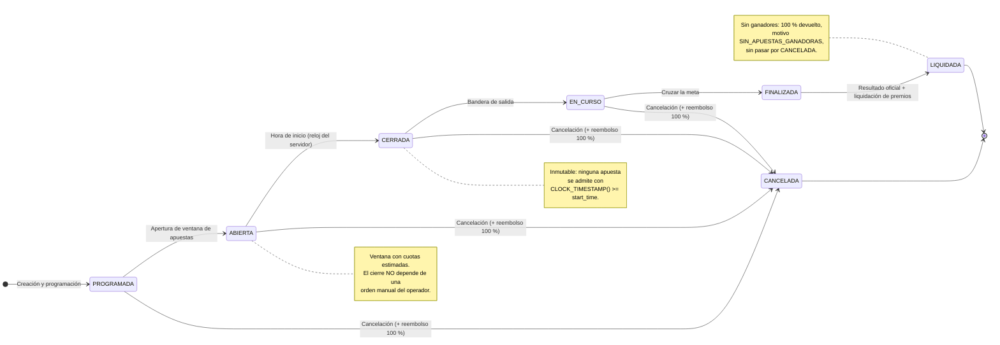

<!-- BANNER:INICIO (bloque estetico; omitido en el PDF consolidado) -->

  

  

  
  
  

  

<!-- BANNER:FIN -->

# DIAGRAMA DE CICLO DE VIDA DE UNA CARRERA
**Caso:** La Gran Liga de Apuestas de Medianos EIA  
**Organización:** Salchipapa Maker Racing S.A.S.  
**Artefacto:** `P1-ART-009D`  
**Uso:** Apoyo visual de la presentación (Slide 04) y del documento técnico. Fuente complementaria de `01_requisitos_y_negocio.md` (P1-1.2).

---

### Reglas representadas (Fuente: `01_requisitos_y_negocio.md`, PDF pág. 3):
- Ciclo formal: `PROGRAMADA → ABIERTA → CERRADA → EN_CURSO → FINALIZADA → LIQUIDADA`.
- `CANCELADA` es alcanzable desde cualquier estado anterior a `FINALIZADA`, con devolución íntegra del 100 %.
- La cancelación es un incidente operativo; la ausencia de ganadores es un desenlace deportivo válido (la carrera llega a `LIQUIDADA`).
