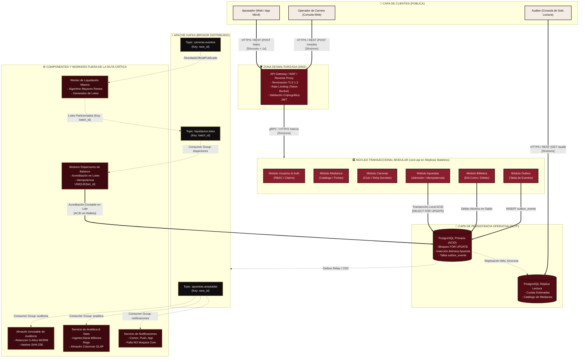

# DIAGRAMA GENERAL DE ARQUITECTURA
**Caso:** La Gran Liga de Apuestas de Medianos EIA  
**Organización:** Salchipapa Maker Racing S.A.S.  
**Entregable Oficial:** Punto 3 del PDF (págs. 17, 18)  
**Artefacto:** `P1-ART-009A`  

---

### Leyenda y Diferenciación Visual Exigida (PDF pág. 17):
- **Línea Sólida (`===`):** **Comunicación Síncrona** en la ruta crítica del usuario y operaciones administrativas interactivas.
- **Línea Punteada (`-.->`):** **Comunicación Asíncrona** basada en eventos a través de Apache Kafka y procesos en segundo plano.
