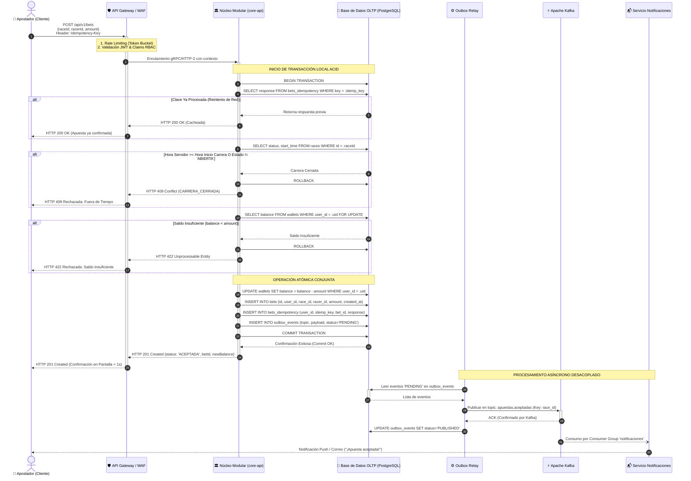

# DIAGRAMA DE SECUENCIA: FLUJO COMPLETO DE UNA APUESTA
**Caso:** La Gran Liga de Apuestas de Medianos EIA  
**Organización:** Salchipapa Maker Racing S.A.S.  
**Entregable Oficial:** Punto 4 del PDF (págs. 17, 18)  
**Artefacto:** `P1-ART-009B`  

---

