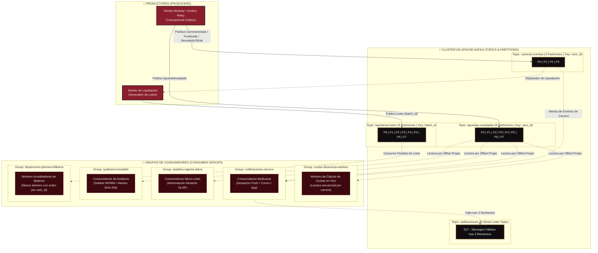

# TOPOLOGÍA DE MENSAJERÍA: APACHE KAFKA
**Caso:** La Gran Liga de Apuestas de Medianos EIA  
**Organización:** Salchipapa Maker Racing S.A.S.  
**Entregable Oficial:** Punto 7 del PDF (págs. 14, 18)  
**Artefacto:** `P1-ART-009C`  

---

